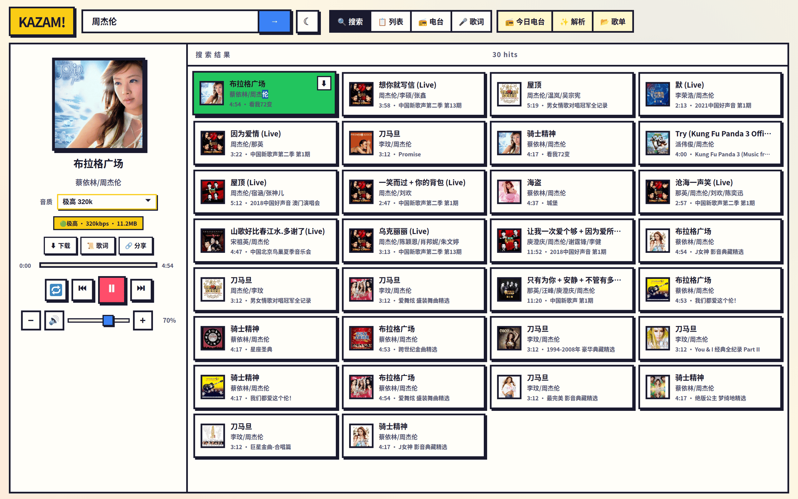
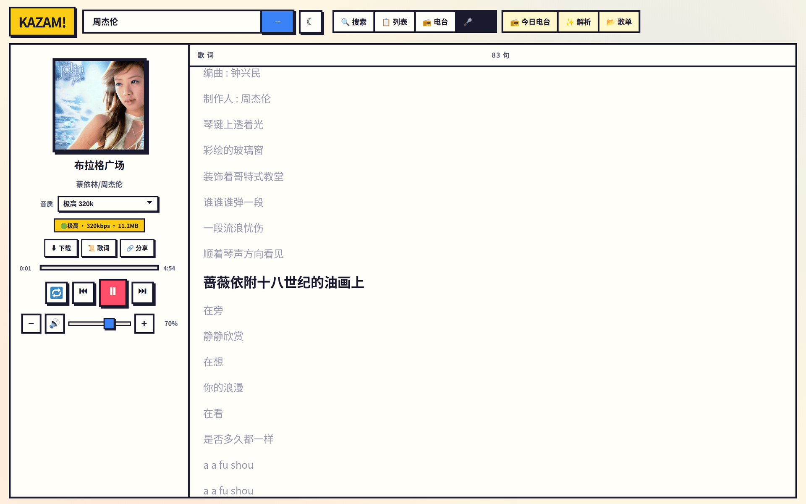
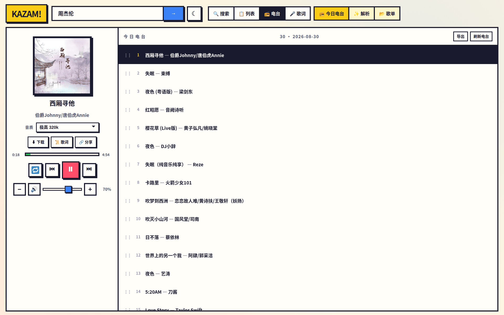
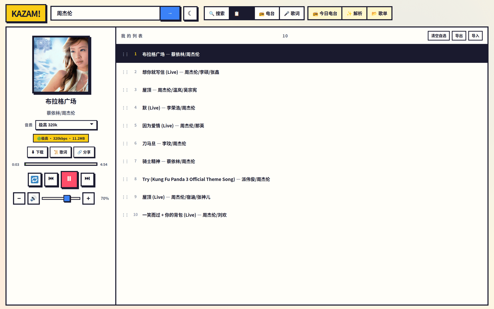
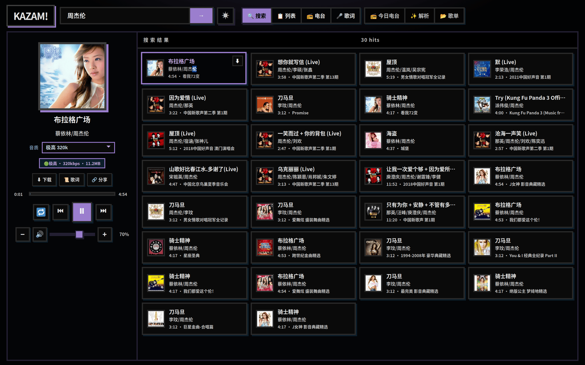

# KAZAM

自托管网页音乐播放器。支持搜索、播放、歌词、音质切换、下载、本机播放列表、今日电台、服务端缓存，以及多上游（Meting / chksz / ORS）。

在线演示：https://music.yeuxark.com

<p align="center">
  
</p>
<p align="center"><em>播放器 + 搜索：选中曲目、封面、音质（极高 320k）与下载 / 歌词 / 分享。</em></p>

<p align="center">
  
  &nbsp;
  
</p>
<p align="center"><em>歌词逐行高亮　·　今日电台（与自选列表分开）</em></p>

<p align="center">
  
  &nbsp;
  
</p>
<p align="center"><em>本机播放列表　·　黑夜模式</em></p>

> 本仓库只包含播放器本身。**不内置任何第三方音频代理地址**。你需要在 `.env` 或后台「上游」里填自己的 Meting / chksz / ORS 实例。不含官方网易云接口、不含账号 Cookie / Token、不含运行时数据。截图来自[在线演示](https://music.yeuxark.com)。

## 功能

| 功能 | 说明 |
|------|------|
| 搜索 / 播放 / 歌词 / 下载 | 基础听歌 |
| 音质切换 | 标准 → 极高 320k → 无损 / Hi-Res / 臻品母带（视上游而定） |
| 本机播放列表 | `localStorage`，浏览器之间互不干扰 |
| 解析填入 | 粘贴歌曲 ID 或网易云链接，自动填歌名、封面 |
| 今日电台 | 随机一批歌，与自选列表分开 |
| 服务端缓存 | 管理员把音频落到磁盘，CDN 过期仍可播 |
| 多上游 | 后台增删测活：Meting / chksz / ORS |
| 稳定播放地址 | `/api/stream/{id}?level=exhigh` |
| 嵌入播放器 | `/embed?id={id}` |

## 快速开始

```bash
python -m venv .venv
# Windows: .venv\Scripts\activate
# Linux / macOS: source .venv/bin/activate
pip install -r requirements.txt
cp .env.example .env
# 编辑 .env：改 ADMIN_PASSWORD、PUBLIC_BASE_URL
python app.py
# → http://127.0.0.1:8080
```

连点左上角 **KAZAM!** Logo 5 次，输入 `ADMIN_PASSWORD`，可管理上游、缓存歌曲。

## Docker

```bash
cp .env.example .env
docker compose up -d --build
```

- 应用：`http://VPS_IP:8080`
- 缓存卷：`kazam_cache` → 容器内 `/app/data/cache`
- 反代示例：`nginx.conf.example`、`deploy/music.yeuxark.com.nginx`

## 环境变量

见 `.env.example`。关键项：

| 变量 | 说明 |
|------|------|
| `PUBLIC_BASE_URL` | 对外根地址（分享 / embed） |
| `CORS_ORIGINS` | 允许跨域的站点 |
| `AUDIO_LEVEL` | 默认音质 |
| `ADMIN_PASSWORD` | 管理员密码，**部署前必须改** |
| `ADMIN_SECRET` | 签发管理员 token 的密钥，**部署前必须改** |
| `UPSTREAM_API` | 可选。chksz 风格接口根地址 |
| `METING_APIS` | 可选。Meting 根地址（逗号分隔） |
| `ORS_API` | 可选。ORS 风格接口根地址 |

`data/runtime.json` 与 `data/cache/` 为运行时数据，已加入 `.gitignore`。

## 音质参数

播放 / 下载 / 缓存均可带 `?level=`：

`standard` · `higher` · `exhigh` · `lossless` · `hires` · `jymaster`

不是每首歌都有母带 / Hi-Res。上游降级时界面会显示实际码率。

## 对接个人站点

```js
// 稳定地址，不要存 CDN 直链
audio.src = `https://your.domain/api/stream/${neteaseId}?level=exhigh`;
```

```
GET /api/parse?q=19723756
GET /api/parse?q=https://music.163.com/song?id=19723756
GET /api/song/{id}?level=jymaster
GET /api/download/{id}?level=jymaster
```

## 不包含什么

刻意没有放进本仓库：

- `.env`、管理员密码、token、证书
- `data/runtime.json`、已缓存音频
- 逆向、探测、抓包、第三方站点镜像
- 私人 Cookie / 账号
- 任何默认第三方音频代理 URL

请自行准备可用的上游实例，并遵守当地法律与上游服务条款。启动后若未配置上游，搜索/播放会失败——这是预期行为。
